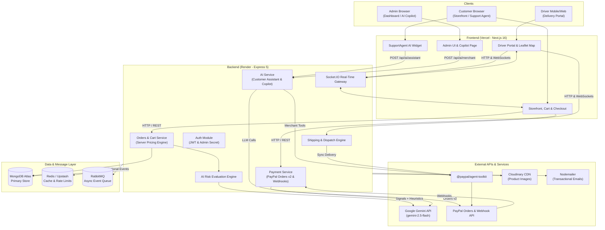

# ShopMate Copilot

> **An AI agent that runs your online store on PayPal.**

ShopMate Copilot is an intelligent, full-stack e-commerce platform designed for the **PayPal AI Hackathon**. It combines PayPal's commerce infrastructure (Orders v2, Webhooks, Delivery Tracking, and the official PayPal Agent Toolkit) with Google Gemini AI to deliver an autonomous merchant assistant, an in-store conversational shopping agent, deterministic fraud risk evaluation, and real-time driver delivery tracking.

---

### 🌐 Live Deployment

| Service | URL | Notes |
| :--- | :--- | :--- |
| **Frontend Storefront** | [https://ecommerce-q1ph.vercel.app](https://ecommerce-q1ph.vercel.app) | Hosted on Vercel (Next.js 16 App Router) |
| **Backend REST API** | [https://ecommerce-9y4y.onrender.com](https://ecommerce-9y4y.onrender.com) | Hosted on Render (Express 5 + TypeScript) |
| **API Health Check** | [https://ecommerce-9y4y.onrender.com/api/health](https://ecommerce-9y4y.onrender.com/api/health) | Wakes up Render free tier and reports service health |

> [!NOTE]
> **Render Free Tier Cold Starts**: Render's free instances spin down after inactivity. The first request may take 30–60 seconds while the container boots up. Pinging `GET /api/health` initiates container wake-up.

---

## 2. What It Does

ShopMate Copilot bridges conversational AI with production-grade PayPal payment workflows:

- **Customer Shopping Assistant**: An in-store floating AI chat assistant that lets shoppers search product catalogs with natural language, check real-time inventory, add items directly to their cart, and track recent orders.
- **PayPal Smart Checkout**: Server-calculated pricing, PayPal Orders v2 integration (`createOrder`, `captureOrder`), and cryptographic webhook verification.
- **AI Order Risk Evaluation**: Automated risk and fraud scoring on every placed order combining deterministic heuristic signals with Google Gemini classification.
- **Merchant AI Copilot**: An admin command center running the official `@paypal/agent-toolkit`, allowing store operators to query transactions, inspect disputes, review invoices, and generate new invoices through a conversational interface with human-in-the-loop confirmation.
- **Delivery Tracking Synced to PayPal**: Automated fulfillment pipeline that syncs courier tracking numbers and delivery status back to PayPal via the Agent Toolkit (`create_shipment_tracking`).
- **Driver Portal & Live Map Tracking**: Dedicated portal for delivery drivers with interactive Leaflet GPS mapping, real-time WebSocket order dispatches, and delivery status updates.

---

## 3. How PayPal Is Used

ShopMate relies on PayPal as its core commerce and transaction engine across multiple integration layers:

```
[ Customer Cart ]
       │
       ▼
[ POST /api/payment/paypal/create-order ]
       │  (Server re-calculates exact total from MongoDB database prices)
       ▼
[ PayPal Orders v2: /v2/checkout/orders ]
       │
       ▼
[ Customer Approves Payment in PayPal Modal ]
       │
       ▼
[ POST /api/payment/paypal/capture ]
       │  (Verifies capture status + ensures idempotency via paypalCaptureId)
       ▼
[ Post-Payment Pipeline ] ──► Creates Shipment ──► Sends Email ──► In-App Notification
       │
       ▼
[ Driver Confirms Delivery ]
       │
       ▼
[ PayPal Agent Toolkit: create_shipment_tracking ] ──► Synced to PayPal Transaction
```

### 1. PayPal Orders v2 Integration
- **Server-Side Price Calculation**: Order totals are strictly calculated on the server from authoritative MongoDB product records (`item.price * item.quantity`). The client cannot manipulate transaction amounts.
- **Order Creation (`createOrder`)**: Initiated via `POST /api/payment/paypal/create-order`, calling PayPal's `/v2/checkout/orders` with `intent: "CAPTURE"`.
- **Order Capture (`captureOrder`)**: Finalized via `POST /api/payment/paypal/capture`, executing `/v2/checkout/orders/{id}/capture`.
- **Capture Idempotency**: Before capturing, the system verifies `order.paypalCaptureId` and `order.payment_status`. If already captured, it returns the existing order record immediately, preventing duplicate charges.

### 2. Webhooks & Cryptographic Signature Verification
- PayPal webhooks are received at `/api/payment/paypal/webhook` (and `/api/payments/paypal/webhook`).
- Configured with `express.raw({ type: "application/json" })` before standard body parsers to preserve the exact raw payload byte stream.
- Verifies authenticity by invoking PayPal's `/v1/notifications/verify-webhook-signature` using the transmission headers (`paypal-auth-algo`, `paypal-cert-url`, `paypal-transmission-id`, `paypal-transmission-sig`, `paypal-transmission-time`, and `PAYPAL_WEBHOOK_ID`).
- Handled events:
  - `PAYMENT.CAPTURE.COMPLETED`: Marks order as paid, records `paypalCaptureId`, and triggers post-payment fulfillment.
  - `PAYMENT.CAPTURE.DENIED`: Flags order payment as failed.
  - `PAYMENT.CAPTURE.REFUNDED`: Marks order as refunded and restores product inventory.

### 3. Resilient Post-Payment Pipeline
- Once payment is captured, the post-payment sequence runs in-process with isolated `try/catch` handlers for guaranteed delivery:
  1. Creates an idempotent `Shipment` record with a unique tracking code (`SM-...`).
  2. Sends an HTML order confirmation email via Nodemailer.
  3. Creates an in-app administrative notification.
  4. Broadcasts order updates over Socket.IO to connected clients.
  5. Publishes an asynchronous event to RabbitMQ (if connected). If RabbitMQ is offline or times out (e.g. cloud port blocks), the in-process fallback ensures shipments, emails, and notifications never fail.

### 4. Shipment Tracking Synced to PayPal
- When a driver completes a delivery (`POST /api/shipping/:id/confirm-delivery`), `syncDeliveryTrackingToPayPal()` invokes the PayPal Agent Toolkit tool `create_shipment_tracking`:
  - Carrier: `OTHER`
  - Status: `DELIVERED`
  - Tracking Number: `shipment.trackingCode`
  - Transaction ID: `order.paypalCaptureId`
  - Sets `shipment.paypalTrackingSynced = true` to guarantee idempotent execution.

### 5. Refunds
- Admins can issue full refunds via `POST /api/payment/paypal/refund/:orderId`.
- Calls PayPal's `/v2/payments/captures/{capture_id}/refund`.
- Sets `order.payment_status = 'refunded'`, `order.status = 'cancelled'`, and automatically increments inventory counts.

### 6. Official PayPal Agent Toolkit (`@paypal/agent-toolkit`)
- Initialized with `@paypal/agent-toolkit/openai` using store credentials and `context: { sandbox: true }`.
- Read and write tools enabled:
  - `list_transactions`: Lists transaction history (automatically clamped to PayPal's 31-day search window).
  - `get_merchant_insights`: Retrieves merchant sales volume and operational statistics.
  - `list_disputes` & `get_dispute`: Discovers customer disputes, chargeback statuses, and claims.
  - `list_invoices`, `get_invoice`, `search_invoicing`: Invoicing queries and status checks.
  - `create_invoice` & `send_invoice`: Drafts and sends official PayPal invoices (human-in-the-loop write operations).
  - `get_order`: Retrieves live PayPal order states.
  - `get_shipment_tracking` & `create_shipment_tracking`: Inspects and attaches tracking metadata.
- **Environment Setting**: Configured via `PAYPAL_ENV=sandbox` (defaults to sandbox, targets `https://api-m.sandbox.paypal.com`).

---

## 4. How AI Is Used

ShopMate Copilot utilizes **Google Gemini** (via `@google/genai`) configured for low latency with `ThinkingLevel.LOW`.

```
                      ┌────────────────────────────────────────┐
                      │            User / Shopper              │
                      └──────────────────┬─────────────────────┘
                                         │
                                         ▼
                             Support Agent Chat Widget
                                         │
                                         ▼
                            POST /api/ai/assistant
                                         │
                      ┌──────────────────┴─────────────────────┐
                      │  Gemini Model (gemini-2.5-flash)       │
                      │  Function Calling / Local Tool Engine  │
                      └──────────────────┬─────────────────────┘
                                         │
          ┌──────────────────┬───────────┴──────────┬──────────────────┐
          ▼                  ▼                      ▼                  ▼
   searchProducts        addToCart             getMyOrders      getMyOrderStatus
   (Catalog Regex)    (User Mongo Cart)     (User Order History) (Tracking Info)
```

### 1. Customer Shopping Assistant (`POST /api/ai/assistant`)
- Embedded in the storefront through `SupportAgent.tsx` (automatically hidden on `/admin` and `/driver` routes).
- Clean conversation history: normalizes roles (`user` vs `model`), strips empty whitespace items, ensures the history starts with a user message, and limits conversation depth to 10 turns.
- Includes a strict 8-second timeout with soft fallbacks ("I'm experiencing a slight connection delay...").
- Local tool calling functions:
  1. `searchProducts(query, maxPrice)`: Searches active catalog items by title, category, and description with regex matching.
  2. `addToCart(productId, qty)`: Validates stock and pushes products directly into the authenticated user's cart.
  3. `getMyOrders(limit)`: Securely retrieves the signed-in user's recent orders (max 5) with statuses, tracking numbers, and delivery estimates.
  4. `getMyOrderStatus(orderId)`: Retrieves delivery updates scoped strictly to the customer's authenticated `user_id`.
- Strict boundaries: The customer system prompt instructs the agent to politely inform users that transaction-level PayPal details, invoicing, and dispute queries are reserved for merchant administrators.

### 2. Order AI Risk Evaluation (`evaluateOrderRisk`)
- Executes asynchronously when orders are placed:
  - Extracts deterministic signal metrics:
    - Order total (`orderTotal`)
    - Customer account age in days (`accountAgeDays`)
    - Orders placed in the last hour (`ordersInLastHour`)
    - Number of distinct saved shipping addresses (`addressChanges`)
  - Evaluates heuristic thresholds: standard carts with established history are approved automatically.
  - Borderline or high-velocity cases invoke Gemini with a structured JSON schema, classifying the order as:
    - `approve`: Normal activity.
    - `review`: Unusually large carts on brand new accounts or rapid purchasing velocity.
    - `flag`: High velocity ($\ge 5$ orders/hour) or abnormal address mutations.
  - **Graceful Degradation**: If the Gemini API is unreachable, times out (8s limit), or encounters a quota limit, the order defaults to `approve` or `review` without interrupting the checkout experience.

### 3. Merchant Copilot (`POST /api/ai/merchant`, `/admin/copilot`)
- An administrative operations assistant designed for store owners.
- **Dynamic Date & Time Context**: Automatically injects current UTC/local ISO timestamps into the system prompt on every turn, allowing the LLM to resolve relative expressions ("this week", "yesterday", "last 30 days") into exact ISO date ranges without querying the user.
- **31-Day Date Clamping**: Automatically validates and clamps transaction search dates to stay within PayPal's mandatory 31-day window.
- **Human-in-the-Loop for Write Actions**:
  - All modifying actions (`create_invoice`, `send_invoice`, `create_order`, `create_refund`, etc.) are intercepted by `isWriteAction()`.
  - The model outputs a `proposedAction` payload specifying the target tool, proposed parameters, and a natural language description.
  - The admin interface renders an interactive confirmation card. The action is only dispatched to PayPal once the admin clicks **Confirm & Execute** (`POST /api/ai/merchant/action`).
- **Quick Action Chips (`POST /api/ai/merchant/quick-chip`)**:
  - Provides instant reports for common operations (`Transactions`, `Insights`, `Disputes`, `Invoices`).
  - Directly invokes PayPal Agent Toolkit read tools without waiting for LLM generation, rendering structured tables in milliseconds.
  - Features an optional **Summarize with AI** action for on-demand LLM synthesis.
- **Sandbox Fault Tolerance**:
  - Automatically inspects tool call responses: HTTP status codes $\ge 400$ or PayPal error payloads (`NOT_AUTHORIZED`, `PERMISSION_DENIED`) are treated as failed tool executions with plain-language explanations.
  - **Insights Fallback**: Because PayPal sandbox accounts frequently lack live merchant insight permissions (returning HTTP 403), the backend automatically falls back to `getLocalDatabaseInsights()` (aggregating real order revenue, active orders, and average order values from MongoDB).
- **Timeouts & Latency Limits**:
  - 20-second timeout per individual model call.
  - 45-second overall timeout for the entire request pipeline.
  - Specific, friendly messaging for timeout events ("The AI took too long, please try again") and quota exhaustion (HTTP 429).

### 4. Core AI Safety Principles
- **AI Proposes, Server Decides and Executes**: The AI never directly modifies prices, updates order states, or issues refunds without server-side validation.
- **Server-Side Authoritative Totals**: Transaction amounts are computed exclusively from database records.
- **Strict Authorization**: Customer assistant tools enforce session `userId` scoping; Merchant Copilot requires verified administrator JWT tokens.
- **Non-Blocking Architecture**: AI failures never block customer login, payment checkout, or package delivery.

---

## 5. Architecture

### System Architecture Diagram



### Data Flow Overview
1. **Catalog & Cart**: Customers browse products and add items to cart via standard REST calls or through the Customer Shopping Assistant (`searchProducts`, `addToCart`).
2. **Order Placement & Risk Assessment**: At checkout, `POST /api/orders` records the pending order, re-computes totals from database prices, and triggers `evaluateOrderRisk` asynchronously with Gemini.
3. **PayPal Payment & Capture**: The frontend renders PayPal Smart Buttons via `@paypal/react-paypal-js`. The backend creates and captures the order against PayPal's Orders v2 API.
4. **Fulfillment Pipeline**: On capture (or webhook receipt), the post-payment pipeline generates shipment records, dispatches customer email receipts, creates notifications, and notifies online drivers over Socket.IO.
5. **Driver Dispatch & PayPal Sync**: A driver accepts the shipment, updates their GPS location on Leaflet maps, and marks the shipment delivered. Upon delivery, the backend invokes PayPal's tracking API via the Agent Toolkit (`create_shipment_tracking`).
6. **Merchant Intelligence**: Administrators open `/admin/copilot` to query store metrics. Read actions (transactions, disputes, invoices) execute through the PayPal Agent Toolkit. Proposed write actions (invoice creation) require explicit admin confirmation.

### Verified Repository Structure

```
hack2/
├── backend/
│   ├── src/
│   │   ├── app.ts                  # Express application setup, routes & middleware
│   │   ├── server.ts               # HTTP & Socket.IO server startup
│   │   ├── config/
│   │   │   ├── cloudinary.ts       # Cloudinary image upload configuration
│   │   │   ├── db.ts               # MongoDB Mongoose connection
│   │   │   ├── rabbitmq.ts         # RabbitMQ connection & fallback handler
│   │   │   ├── redis.ts            # Redis client configuration
│   │   │   └── socket.ts           # Socket.IO connection & event handlers
│   │   ├── middleware/
│   │   │   ├── admin.middleware.ts # Admin role authorization check
│   │   │   ├── auth.middleware.ts  # Customer JWT authentication
│   │   │   ├── driverAuth.middleware.ts # Driver JWT authentication
│   │   │   └── rateLimit.middleware.ts  # Express rate limiters
│   │   ├── models/                 # Mongoose data models (User, Product, Order, Shipment, etc.)
│   │   ├── modules/
│   │   │   ├── ai/                 # AI service, copilot, assistant & PayPal toolkit integration
│   │   │   │   ├── ai.controller.ts
│   │   │   │   ├── ai.middleware.ts
│   │   │   │   ├── ai.routes.ts
│   │   │   │   ├── ai.service.ts
│   │   │   │   └── paypal-toolkit.ts
│   │   │   ├── auth/               # Customer & Admin authentication handlers
│   │   │   ├── cart/               # Cart validation, summary & items
│   │   │   ├── categories/         # Category tree & catalog classification
│   │   │   ├── chat/               # Delivery chat & message history
│   │   │   ├── drivers/            # Driver accounts, locations & active assignments
│   │   │   ├── notifications/      # Administrative alerts & read status
│   │   │   ├── orders/             # Order creation, history & cancellation
│   │   │   ├── payment/            # PayPal Orders v2, webhooks & refund providers
│   │   │   │   └── providers/
│   │   │   │       ├── payment.interface.ts
│   │   │   │       └── paypal.provider.ts
│   │   │   ├── products/           # Product CRUD & image uploads
│   │   │   ├── shipping/           # Shipment creation, tracking & delivery confirmation
│   │   │   └── users/              # User profiles, addresses & preferences
│   │   ├── routes/
│   │   │   └── auth.routes.ts      # Authentication route aggregator
│   │   └── utils/
│   │       └── logger.ts           # Pino structured logger
│   ├── package.json
│   └── tsconfig.json
├── frontend/
│   ├── app/
│   │   ├── (auth)/                 # Customer login & registration
│   │   ├── (user)/                 # Customer profile & account management
│   │   ├── admin/                  # Administrative dashboard
│   │   │   ├── categories/         # Category management
│   │   │   ├── copilot/            # Merchant AI Copilot chat interface
│   │   │   ├── drivers/            # Driver approvals & blocking
│   │   │   ├── notifications/      # Store alerts
│   │   │   ├── orders/             # Order list & risk badges
│   │   │   ├── products/           # Product inventory management
│   │   │   ├── login/              # Admin login
│   │   │   └── register/           # Admin registration with ADMIN_SECRET_KEY
│   │   ├── cart/                   # Customer shopping cart
│   │   ├── categories/             # Category navigation
│   │   ├── components/             # Reusable UI components & SupportAgent widget
│   │   ├── context/                # React Context providers (Auth, Cart, Socket)
│   │   ├── driver/                 # Driver portal (dashboard, deliveries, Leaflet map)
│   │   ├── orders/                 # Customer checkout & order tracking pages
│   │   ├── products/               # Product catalog & detail views
│   │   ├── layout.tsx              # Root HTML layout
│   │   └── page.tsx                # Storefront homepage
│   ├── package.json
│   ├── next.config.mjs
│   └── tsconfig.json
└── README.md
```

---

## 6. Tech Stack

### Backend

| Package / Technology | Version | Purpose |
| :--- | :--- | :--- |
| **Node.js** | `>=18.0.0` | Server runtime environment |
| **Express** | `^5.2.1` | REST API framework and routing |
| **TypeScript** | `^5.9.3` | Type-safe backend architecture |
| **@paypal/agent-toolkit** | `^1.11.0` | Official PayPal AI Agent Toolkit for transaction and invoice operations |
| **@google/genai** | `^2.29.1` | Official Google Gemini SDK for conversational AI and tool calling |
| **mongoose** | `^9.2.2` | MongoDB ODM for schemas and persistence |
| **redis** | `^5.11.0` | In-memory cache and rate limiting |
| **socket.io** | `^4.8.3` | Real-time bi-directional WebSocket gateway |
| **amqplib** | `^0.10.9` | RabbitMQ messaging client (with in-process fallback) |
| **cloudinary** | `^1.41.3` | Cloud image storage and CDN delivery |
| **nodemailer** | `^8.0.1` | Transactional order confirmation emails |
| **pino** & **pino-http** | `^10.3.1` | Structured JSON application logging |
| **@sentry/node** | `^10.40.0` | Application performance and exception monitoring |
| **bcryptjs** & **jsonwebtoken** | `^3.0.3` / `^9.0.3` | Secure password hashing and JWT token issuance |

### Frontend

| Package / Technology | Version | Purpose |
| :--- | :--- | :--- |
| **Next.js** | `^16.1.6` | App Router React framework with SSR and streaming |
| **React** & **React DOM** | `^19.2.4` | Modern UI rendering library |
| **TypeScript** | `^5.9.3` | Type-safe frontend codebase |
| **Tailwind CSS** | `^4.2.1` | Utility-first responsive styling |
| **@paypal/react-paypal-js** | `^10.6.0` | Official PayPal Smart Payment Buttons SDK |
| **lucide-react** | `^1.55.0` | Modern SVG icon collection |
| **leaflet** & **react-leaflet** | `^1.9.4` / `^5.0.0` | Interactive maps for real-time delivery GPS tracking |
| **socket.io-client** | `^4.8.3` | Client-side WebSocket connection for real-time updates |
| **react-markdown** | `^10.1.0` | Markdown rendering for AI assistant and Copilot responses |
| **@sentry/nextjs** | `^10.40.0` | Client-side error telemetry |

---

## 7. Try It as a Judge (Step-by-Step Walkthrough)

Follow this structured evaluation guide to test all key user journeys on the live deployments.

### Test Accounts Reference

| Role | Login Route | Email Placeholder | Password Placeholder | Purpose |
| :--- | :--- | :--- | :--- | :--- |
| **Admin** | `/admin/login` | `admin@shopmate.com` | `<admin_password>` | AI Copilot, risk inspection, catalog & order management |
| **Driver** | `/driver/login` | `driver@shopmate.com` | `<driver_password>` | Delivery dispatch, GPS map tracking, completion sync |
| **Customer** | `/login` | `buyer@example.com` | `<customer_password>` | Store shopping, customer assistant, cart & checkout |

> [!TIP]
> **Need a Fresh Account?**
> - Register a customer at `https://ecommerce-q1ph.vercel.app/register`.
> - Register a driver at `https://ecommerce-q1ph.vercel.app/driver/register`.
> - Register an administrator at `https://ecommerce-q1ph.vercel.app/admin/register` using your configured `ADMIN_SECRET_KEY`.

---

### Step 1: Customer Journey (Shopping & AI Assistant)
1. Navigate to the storefront: [https://ecommerce-q1ph.vercel.app](https://ecommerce-q1ph.vercel.app).
2. Open the **Customer Support Agent** by clicking the floating chat icon in the bottom-right corner.
3. Test natural language discovery:
   - Type: *"What products do you have available?"*
   - Type: *"Do you have any electronics under $1000?"*
   - Notice the AI returns catalog results with real prices and inventory.
4. Add an item to your cart directly from chat:
   - Type: *"Add 1 of the first item to my cart"*.
   - The assistant invokes `addToCart` and updates your cart counter.
5. Alternatively, browse the catalog and click **Add to Cart** on any product page.
6. Open your cart at `/cart` and click **Proceed to Checkout**.

---

### Step 2: PayPal Checkout & Order Placement
1. On the checkout page (`/orders/checkout`), fill in your shipping details.
2. The PayPal Smart Payment Buttons will render.
3. Click the **PayPal** button. A PayPal Sandbox modal will open.
4. Log in with a **PayPal Sandbox Personal Buyer Account**:
   - Create one under your [PayPal Developer Dashboard](https://developer.paypal.com/dashboard/accounts) $\rightarrow$ *Sandbox Accounts* (e.g. `sb-buyer@personal.example.com`).
5. Confirm the sandbox payment.
6. Upon approval:
   - The backend validates the payment and captures the order.
   - The post-payment pipeline automatically creates a shipment with a tracking number and sends an order confirmation email.
   - You are redirected to `/orders/[id]` showing status **Paid** and initial shipping status **Processing**.
7. Re-open the customer chat widget and test:
   - Type: *"Where is my latest order?"*
   - The assistant triggers `getMyOrders` and reports your order ID, payment status, and tracking code.

---

### Step 3: Admin Journey (Risk Engine & AI Copilot)
1. Go to [https://ecommerce-q1ph.vercel.app/admin/login](https://ecommerce-q1ph.vercel.app/admin/login) and log in.
2. Visit **Orders** (`/admin/orders`):
   - Locate the order you just placed.
   - Observe the **AI Risk Assessment Badge** (e.g., `Approved - Low Risk` or `Review - Borderline`). The signal panel displays account age, order velocity, and evaluation rationale.
3. Open the **AI Copilot** at `/admin/copilot`:
   - Notice that the customer chat widget is automatically hidden on admin routes.
   - **Test Quick Action Chips**:
     - Click **Transactions (7d)**: Instantly retrieves recent transactions from PayPal via `@paypal/agent-toolkit`.
     - Click **Sales Insights**: Retrieves revenue and order metrics (with automatic fallback to MongoDB data if sandbox insights permissions are restricted).
     - Click **Disputes**: Queries PayPal dispute records.
     - Click **Invoices**: Displays recent store invoices.
   - **Test Conversational Intelligence**:
     - Type: *"What were our sales this week?"* (The Copilot calculates dates based on today's injected calendar timestamp).
     - Type: *"Are there any open customer disputes?"*
   - **Test Human-in-the-Loop Invoice Creation**:
     - Type: *"Create an invoice for client@example.com for $75 for Expedited Shipping Services"*.
     - The Copilot recognizes a write action and presents an interactive **Proposed Action Card** with invoice parameters.
     - Click **Confirm & Execute** to dispatch the invoice creation to PayPal.
4. Test refund capabilities: Under `/admin/orders`, click **Refund** on an eligible order to trigger the PayPal `/v2/payments/captures/{id}/refund` endpoint.

---

### Step 4: Driver Journey (Live Dispatch & PayPal Delivery Sync)
1. In an incognito tab or separate browser, navigate to `/driver/login` and log in.
2. On the **Driver Dashboard** (`/driver/dashboard`), toggle your status to **Available**.
3. Accept the delivery assignment created in Step 2.
4. Navigate to the active delivery view:
   - View the pickup and delivery addresses displayed on the interactive **Leaflet map**.
   - Status transitions (e.g., *Picked Up*, *In Transit*) broadcast live over WebSockets to the customer's order page.
5. Click **Confirm Delivery**:
   - The shipment is marked `delivered`.
   - The backend automatically invokes `syncDeliveryTrackingToPayPal()`, calling `@paypal/agent-toolkit` to update the transaction with carrier and tracking metadata.

---

### Known Sandbox Quirks & Limitations
- **Render Free Tier Cold Starts**: Allow 30–60 seconds for the first request if the backend container is inactive.
- **PayPal Sandbox Insights 403**: Standard PayPal developer sandbox accounts do not always have permissions for PayPal's reporting insights API (`get_merchant_insights`). ShopMate Copilot automatically detects HTTP 403 errors and serves real aggregate store insights from MongoDB.

---

## 8. Run It Locally

### Prerequisites
- **Node.js**: `v18.0.0` or higher (Node 20+ recommended)
- **npm**: `v9.0.0` or higher
- **MongoDB Atlas** (or local MongoDB on port 27017)
- **Redis**: Local Redis instance or a cloud provider (e.g., [Upstash Redis](https://upstash.com))
- **PayPal Developer Account**: App Client ID & Secret from [developer.paypal.com](https://developer.paypal.com)
- **Google AI Studio Key**: API Key for Gemini from [aistudio.google.com](https://aistudio.google.com)
- **Cloudinary Account**: Cloud name, API key & secret from [cloudinary.com](https://cloudinary.com)

---

### Step-by-Step Setup

#### 1. Clone Repository
```bash
git clone https://github.com/<your-username>/ShopMate.git
cd ShopMate
```

#### 2. Configure Backend
```bash
cd backend
cp .env.example .env
```
Open `.env` in your editor and configure the required keys (see [Environment Variables](#9-environment-variables) below).

Install dependencies and compile TypeScript:
```bash
npm install
npm run build
```

Start the backend in development mode:
```bash
npm run dev
# The API will be listening on http://localhost:4000
```

#### 3. Configure Frontend
In a new terminal window:
```bash
cd frontend
cp .env.example .env.local
```
Configure `.env.local`:
```env
NEXT_PUBLIC_API_URL=http://localhost:4000/api
NEXT_PUBLIC_SOCKET_URL=http://localhost:4000
NEXT_PUBLIC_PAYPAL_CLIENT_ID=<your_paypal_sandbox_client_id>
```

Install dependencies:
```bash
npm install
```

Start the frontend development server:
```bash
npm run dev
# The storefront will be accessible at http://localhost:8081 (or http://localhost:3000)
```

---

### Initial Store Setup

#### 1. Create Your Admin Account
Admins cannot be created through standard registration. Register your first admin user by visiting `http://localhost:8081/admin/register` (or via REST):
```bash
curl -X POST http://localhost:4000/api/auth/admin/register \
  -H "Content-Type: application/json" \
  -d '{
    "name": "Store Administrator",
    "email": "admin@shopmate.com",
    "password": "<your_secure_password>",
    "adminSecretKey": "<your_configured_ADMIN_SECRET_KEY>"
  }'
```

#### 2. Set Up the Product Catalog
1. Log in to the admin panel at `http://localhost:8081/admin/login`.
2. Go to **Categories** (`/admin/categories`) and create a category (e.g., "Electronics" or "Apparel").
3. Go to **Products** (`/admin/products`) and add a product with a title, description, price, stock, and product image.
4. Your catalog is now ready for customer shopping and AI exploration.

---

## 9. Environment Variables

### Backend (`backend/.env`)

| Variable | Required | Default / Example | Description |
| :--- | :--- | :--- | :--- |
| `PORT` | Optional | `4000` | HTTP port for the Express application |
| `NODE_ENV` | Optional | `development` | Runtime environment (`development` or `production`) |
| `FRONTEND_URL` | Required | `http://localhost:3000` | Allowed CORS origin for frontend requests |
| `MONGO_URI` | Required | `mongodb+srv://<user>:<password>@cluster.mongodb.net/aura_db` | MongoDB connection string |
| `REDIS_URL` | Required | `rediss://default:<password>@<host>:6379` | Redis connection URL (Supports TLS `rediss://`) |
| `JWT_SECRET` | Required | `<your_jwt_secret_key_here>` | Signing secret for customer & driver JWTs |
| `ADMIN_SECRET_KEY` | Required | `<your_admin_secret_key_here>` | Required passphrase to register new admin accounts |
| `PAYPAL_CLIENT_ID` | Required | `<your_paypal_client_id>` | PayPal REST API app Client ID |
| `PAYPAL_CLIENT_SECRET`| Required | `<your_paypal_client_secret>` | PayPal REST API app Client Secret |
| `PAYPAL_WEBHOOK_ID` | Required | `<your_paypal_webhook_id>` | Webhook ID from PayPal Developer Dashboard |
| `PAYPAL_ENV` | Optional | `sandbox` | PayPal mode: `sandbox` or `live` |
| `GEMINI_API_KEY` | Required | `<your_gemini_api_key>` | Google Gemini API key for AI Copilot & Risk Engine |
| `GEMINI_MODEL` | Optional | `gemini-2.5-flash` | Gemini model name (default: `gemini-2.5-flash`) |
| `CLOUDINARY_CLOUD_NAME`| Required | `<your_cloud_name>` | Cloudinary cloud identifier |
| `CLOUDINARY_API_KEY` | Required | `<your_api_key>` | Cloudinary API key |
| `CLOUDINARY_API_SECRET`| Required | `<your_api_secret>` | Cloudinary API secret |
| `SMTP_HOST` | Optional | `smtp.gmail.com` | SMTP email server hostname |
| `SMTP_PORT` | Optional | `587` | SMTP server port |
| `SMTP_USER` | Optional | `support@shopmate.com` | SMTP authentication username |
| `SMTP_PASS` | Optional | `<your_app_password>` | SMTP authentication password |
| `EMAIL_FROM` | Optional | `"ShopMate <support@shopmate.com>"` | Sender email address for order notifications |
| `RABBITMQ_URL` | Optional | `amqp://localhost:5672` | AMQP queue URL (System safely falls back in-process if offline) |
| `LOG_LEVEL` | Optional | `info` | Pino log level (`trace`, `debug`, `info`, `warn`, `error`) |

> [!IMPORTANT]
> **Redis TLS & Cloud Providers**: When using Upstash Redis or managed Redis clusters over TLS, use the `rediss://` protocol prefix and supply credentials for the default read-write user (`rediss://default:<password>@<host>:<port>`).

---

### Frontend (`frontend/.env` or `frontend/.env.local`)

| Variable | Required | Default / Example | Description |
| :--- | :--- | :--- | :--- |
| `NEXT_PUBLIC_API_URL` | Required | `http://localhost:4000/api` | Base URL for backend REST API endpoints |
| `NEXT_PUBLIC_SOCKET_URL` | Required | `http://localhost:4000` | Base URL for Socket.IO real-time WebSocket connection |
| `NEXT_PUBLIC_PAYPAL_CLIENT_ID`| Required | `<your_paypal_client_id>` | PayPal Client ID for `@paypal/react-paypal-js` SDK |
| `NEXT_PUBLIC_SENTRY_DSN` | Optional | `<your_sentry_dsn>` | Sentry DSN for client error tracking |

---

## 10. Deployment

### Render (Backend Deployment)
1. Create a new **Web Service** on [Render](https://render.com) connected to your repository.
2. Configure settings:
   - **Root Directory**: `backend`
   - **Environment**: `Node`
   - **Build Command**: `npm install && npm run build`
   - **Start Command**: `npm run start` (runs `node dist/server.js`)
   - **Health Check Path**: `/api/health`
3. Add all backend environment variables listed in Section 9.

### Vercel (Frontend Deployment)
1. Import the repository into [Vercel](https://vercel.com).
2. Configure settings:
   - **Framework Preset**: `Next.js`
   - **Root Directory**: `frontend`
   - **Build Command**: `npm run build`
3. Configure environment variables:
   - `NEXT_PUBLIC_API_URL`: Set to your live Render API URL (`https://ecommerce-9y4y.onrender.com/api`).
   - `NEXT_PUBLIC_SOCKET_URL`: Set to your live Render WebSocket URL (`https://ecommerce-9y4y.onrender.com`).
   - `NEXT_PUBLIC_PAYPAL_CLIENT_ID`: Your PayPal Sandbox Client ID.

### PayPal Developer Dashboard Configuration
1. Log in to [developer.paypal.com](https://developer.paypal.com).
2. Under **Apps & Credentials**, create a new REST API app in the **Sandbox** tab.
3. Note your **Client ID** and **Secret Key**.
4. Scroll to **Webhooks** and click **Add Webhook**:
   - Webhook URL: `https://ecommerce-9y4y.onrender.com/api/payment/paypal/webhook`
   - Event types to subscribe:
     - `Payment capture completed`
     - `Payment capture denied`
     - `Payment capture refunded`
5. Copy the generated **Webhook ID** into your backend's `PAYPAL_WEBHOOK_ID` environment variable.

---

## 11. API Overview

All routes are prefixed with `/api`. Verified against backend router declarations:

| Group | Method | Endpoint | Access | Description |
| :--- | :--- | :--- | :--- | :--- |
| **System** | `GET` | `/health` | Public | System health check (Mongo, Redis, AI, RabbitMQ status) |
| **Auth** | `POST` | `/auth/register` | Public | Register customer account |
| | `POST` | `/auth/login` | Public | Customer login (rate limited: 5 req/min) |
| | `GET` | `/auth/me` | Authenticated | Retrieve authenticated customer profile |
| | `POST` | `/auth/admin/register` | Public | Register admin (requires `adminSecretKey`) |
| | `POST` | `/auth/admin/login` | Public | Admin login |
| **Products** | `GET` | `/products` | Public | List active products with pagination & filters |
| | `GET` | `/products/:id` | Public | Get single product details |
| | `POST` | `/products` | Admin | Create product with up to 5 image uploads |
| | `PUT` | `/products/:id` | Admin | Update existing product |
| | `DELETE`| `/products/:id` | Admin | Archive or delete product |
| **Categories** | `GET` | `/categories` | Public | Get all categories |
| | `GET` | `/categories/tree` | Public | Get category hierarchical tree |
| | `POST` | `/categories` | Admin | Create new product category |
| **Cart** | `GET` | `/cart` | Authenticated | Get current user's active cart |
| | `POST` | `/cart` | Authenticated | Add item to cart with stock validation |
| | `PUT` | `/cart/:itemId` | Authenticated | Update item quantity |
| | `DELETE`| `/cart/:itemId` | Authenticated | Remove specific item |
| | `DELETE`| `/cart` | Authenticated | Clear entire cart |
| **Orders** | `POST` | `/orders` | Authenticated | Create order & trigger AI risk assessment |
| | `GET` | `/orders/my` | Authenticated | List user's placed orders |
| | `GET` | `/orders/:id` | Authenticated | Get single order details |
| | `PUT` | `/orders/:id/cancel` | Authenticated | Cancel unpaid order |
| | `GET` | `/orders` | Admin | List all store orders |
| | `PUT` | `/orders/:id/status` | Admin | Update order status |
| **Payments** | `POST` | `/payment/paypal/create-order` | Authenticated | Create PayPal Orders v2 transaction |
| | `POST` | `/payment/paypal/capture` | Authenticated | Capture approved PayPal order |
| | `POST` | `/payment/paypal/webhook` | Public | Raw body PayPal webhook receiver |
| | `POST` | `/payment/paypal/refund/:orderId` | Admin | Refund captured PayPal order |
| **AI** | `POST` | `/ai/assistant` | Optional Auth | Customer shopping assistant (Gemini + tools) |
| | `POST` | `/ai/merchant` | Admin | Merchant Copilot (Gemini + PayPal Agent Toolkit) |
| | `POST` | `/ai/merchant/action` | Admin | Execute proposed write action (human-in-the-loop) |
| | `POST` | `/ai/merchant/quick-chip`| Admin | Fast direct read tool execution without LLM latency |
| **Shipping** | `GET` | `/shipping/order/:orderId` | Authenticated | Get shipment & tracking details for order |
| | `PUT` | `/shipping/:id/status` | Driver | Update shipment transit status |
| | `POST` | `/shipping/:id/confirm-delivery` | Driver | Mark delivered & sync tracking to PayPal |
| **Drivers** | `POST` | `/drivers/register` | Public | Register new delivery driver |
| | `POST` | `/drivers/login` | Public | Driver authentication |
| | `GET` | `/drivers/me` | Driver | Get driver profile and status |
| | `PUT` | `/drivers/status` | Driver | Update availability status (`available`, `busy`, `offline`) |
| | `PUT` | `/drivers/location` | Driver | Update driver GPS latitude/longitude |
| | `GET` | `/drivers/delivery/active` | Driver | Get active delivery assignment |
| | `GET` | `/drivers/all` | Admin | List all registered drivers |
| | `PUT` | `/drivers/:id/approve` | Admin | Approve pending driver |

---

## 12. Logging and Troubleshooting

### Structured Logging System
The application utilizes structured JSON logging through Pino with domain tags:

- `[ai]`: Logs Gemini model calls, token counts, tool execution times, fallbacks, and schema validation.
- `[paypal]`: Logs PayPal REST calls, OAuth tokens, webhook signature verifications, and tracking syncs.
- `[payment]`: Logs payment state changes, capture idempotency checks, and refund executions.
- `[driver]`: Logs driver location updates, assignment dispatches, and delivery status transitions.
- `[socket]`: Logs WebSocket connections, room subscriptions, and real-time broadcasts.
- `[rabbitmq]`: Logs AMQP connection attempts and in-process fallbacks.

### Service Health Check (`GET /api/health`)
Querying `/api/health` returns the operational status of critical subsystems:

```json
{
  "ok": true,
  "mongo": "connected",
  "redis": "connected",
  "rabbitmq": false,
  "cloudinary": "configured",
  "ai": true,
  "paypalToolkit": true,
  "uptime": 1420.5
}
```

### Common Issues & Troubleshooting

| Problem | Root Cause | Solution |
| :--- | :--- | :--- |
| **503 on First Request / Delayed Response** | Render free tier instance is spinning up from cold sleep. | Wait 30–60 seconds or ping `GET /api/health` to trigger container startup. |
| **Redis Connection Refused / ECONNRESET** | Connecting to a TLS-enabled Redis cluster without `rediss://` or invalid credentials. | Verify your `REDIS_URL` uses `rediss://default:<password>@<host>:<port>`. |
| **RabbitMQ ETIMEDOUT / Connection Refused** | Cloud environments (such as Render) blocking outbound AMQP ports (5671/5672). | No action required. The backend automatically detects the failure and runs all post-payment tasks (shipment, email, notifications) in-process. |
| **PayPal Insights Returns 403 Forbidden** | PayPal Developer Sandbox accounts often lack live merchant reporting permissions. | Expected sandbox behavior. ShopMate Copilot automatically detects HTTP 403 and falls back to MongoDB sales insights. |
| **Gemini AI Rate Limits / 429 Errors** | Exceeded free-tier Gemini API quota. | The system catches rate limit errors and returns user-friendly degradation notices without crashing the server. |
| **Support Agent Widget Missing on Admin** | By design. The customer support bubble is suppressed on `/admin` and `/driver` routes. | Use the dedicated **AI Copilot** page (`/admin/copilot`) for administrative operations. |

---

## 13. Roadmap

Planned enhancements for future versions of ShopMate Copilot:

- **PayPal Payouts for Delivery Drivers**: Implement the PayPal Payouts API to enable automated, instant batch disbursements to delivery drivers upon delivery confirmation.
- **PayPal Subscriptions & Recurring Billing**: Integration with the PayPal Subscriptions API to support recurring subscription boxes and memberships.
- **Multi-Currency Support**: Expand catalog pricing and PayPal Orders v2 integration to support dynamic multi-currency checkouts with real-time conversion.
- **Autonomous Multi-Agent Orchestration**: Multi-agent collaboration where an inventory restocking agent automatically generates supplier purchase orders when product stock dips below threshold levels.
- **Automated Dispute Resolution**: AI-assisted dispute response generator that gathers order history, tracking confirmations, and courier delivery signatures to prepare PayPal dispute evidence packages.
